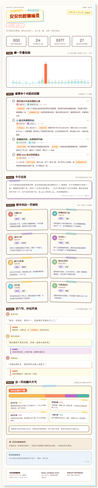

# 群聊摘录 · Group Notebook

把群里一天的聊天记录整理成一页 **手账风「群聊摘录」长图**：统计邮票卡、24 小时活跃
轨迹、值得夹书签的话题、群友侧写、抄在页角的金句、这一页的聊天天气，外加咖啡推荐和
睡前碎碎念。

面向 [Neo-MoFox](https://github.com/MoFox-Studio/Neo-MoFox) 插件系统开发，遵循官方
插件规范（`manifest.json` + 组件注册 + 插件面 API），视觉版式致敬
[astrbot_plugin_qq_group_daily_analysis](https://github.com/SXP-Simon/astrbot_plugin_qq_group_daily_analysis)
的 Scrapbook 手账主题，渲染管线为 **HTML 手账模板 + Playwright 截图**。



## 功能

- **每天定时投递**：到点自动统计当天消息、生成手账并发送到配置的群（默认关闭，
  与「群日报」等同类插件并存时先手动验证再开启）。
- **手动补发**：`/摘录`、`/摘录 2026-11-05`、`/摘录 昨天`。
- **只出图不发送**：`/摘录 预览`，方便调排版；`/摘录 重做` 忽略旧图重新生成。
- **LLM 结构化文案**：一次请求生成话题、**今日总结**（一整段聊天内容回顾）、
  群友侧写（称号/MBTI/标签）、金句锐评、聊天天气与碎碎念，人设与附加提示词可在配置里自定义。
- **防幻觉校验**：昵称必须能对齐到聊天记录，金句原文必须真实出现过，
  聊天天气百分比按真实统计重算；模型不可用时自动回退到规则版文案。
- **本地留档**：PNG/JSON 存在 `data/group_notebook/reports/`，按天数自动清理。
- **独立页面**：挂到主程序 HTTP 服务器，地址**动态跟随主程序配置**
  `config/core.toml` 的 `[http_router]`（`http_router_host` / `http_router_port`），
  形如 `http://<host>:<port>/plugins/group-notebook/`；插件加载日志会打印完整地址，
  页面页脚也会显示当前地址。选群选日期、历史画廊、手账预览、手动生成，不依赖官方 Plugin UI。
- **封面壁纸**：独立页面上传壁纸（PNG/JPEG/WebP/GIF，≤8MB），支持九宫格焦点裁切
  与立绘高度调节，改参数不用重新上传；上传的封面优先于配置里的
  `notebook.character_path`，删除封面即回退。

## 安装

### 1. 放进插件目录

- **方式 A（推荐）**：到 [Releases](https://github.com/mutoujun080415/group_notebook/releases)
  下载最新的 `group_notebook-x.y.z.mfp`，放进 Neo-MoFox 的 `plugins/` 目录。
- **方式 B**：把整个仓库克隆/复制为 `plugins/group_notebook/`
  （`git clone https://github.com/mutoujun080415/group_notebook.git`）。
- 也可以自己用 MPDT 打包成 `.mfp` 后放入 `plugins/`。

放好后重启 Bot。

### 2. 安装渲染依赖

渲染管线依赖 `jinja2` 与 `playwright`（manifest 已声明，框架的依赖安装器会尝试
自动安装；也可以手动装）：

```bash
uv add jinja2 playwright
```

浏览器三选一：

- **复用系统 Edge（推荐，Windows 免下载）**：保持配置默认
  `notebook.browser_channel = "msedge"` 即可，无需下载浏览器。
- 复用系统 Chrome：`browser_channel = "chrome"`。
- 使用 Playwright 内置 Chromium：

  ```bash
  uv run playwright install chromium
  ```

  并把 `browser_channel` 留空。

### 3. 字体（可选但推荐）

`assets/fonts/` 已内置三款可免费商用的字体：

| 文件 | 字体 | 用途 | 协议 |
| --- | --- | --- | --- |
| `ZCOOLKuaiLe-Regular.ttf` | 站酷快乐体 | 标题 | OFL |
| `LXGWWenKai-Regular.ttf` | 霞鹜文楷 | 手写正文 | OFL |
| `LXGWWenKai-Medium.ttf` | 霞鹜文楷 Medium | 手写强调 | OFL |

缺字体不会阻塞渲染，模板会回退到系统楷体/雅黑字体栈。

### 4. 配置

首次加载会在 `config/plugins/group_notebook/config.toml` 生成默认配置，重点：

```toml
[general]
groups = ["123456789"]            # 要投递的群号
group_aliases = ["123456789=大肥鱼值班室"]
send_time = "23:30"               # 自动投递时间
auto_send = false                 # 默认关闭，先手动验证再开
platform = "qq"

[analysis]
model_task = "utils"              # config/model.toml 里的模型任务
persona = "你是一册手账的整理者……"  # 文案人设
custom_prompt = ""                # 附加提示词

[notebook]
room_name = "本群"
bot_name = "安安"                 # 手账所有者，标题会自动生成「安安的群聊摘录」
page_title = ""                   # 留空自动生成
character_path = ""               # 右侧立绘路径（绝对路径或相对插件目录），留空不显示
browser_channel = "msedge"
coffee_enabled = true
murmur_enabled = true

[webui]
route_path = "/plugins/group-notebook"
```

## 使用

- 群里发送 `/摘录`（或 `/摘录 昨天`、`/摘录 11-05`）生成并发送当天手账。
- `/摘录 预览` 只出图不发送；`/摘录 重做` 忽略旧图重新生成。
- 浏览器打开独立页面：地址跟随 `config/core.toml` 的 `[http_router]`
  （host/port 改了 WebUI 跟着变，无需改插件），插件加载日志与页面页脚都会
  显示当前完整地址；子路径可在插件配置 `webui.route_path` 里改。
  选群选日期生成、预览历史。
- 想每天自动发：配置 `auto_send = true` 并确认 `groups` 已填。
  **注意**：与 `group_daily_log`（群日报）并存时两者都会投递，按需保留一个的自动发送。

## 开发与测试

```bash
# 离线单元测试（不需要启动机器人；在 bot 环境外会注入框架替身）
python -m pytest tests -q

# 语法检查
python -m compileall group_notebook

# 离线渲染演示（假数据直出一张手账，用于排版调试）
python scripts/demo_render.py
```

## 与群日报（group_daily_log）的区别

| | 群日报 · Daily Log | 群聊摘录 · Group Notebook |
| --- | --- | --- |
| 渲染 | Pillow 直接绘制 | HTML 手账模板 + Playwright 截图 |
| 版式 | 蓝白海报风 | 手账/剪贴簿风（胶带、邮票卡、横线信纸、荧光笔） |
| 文案 | 话题/图鉴/名言/洞察 | 话题（带参与者胶囊）/今日总结/侧写（称号+MBTI+标签）/金句锐评/聊天天气/咖啡/碎碎念 |
| 依赖 | pillow | jinja2 + playwright（浏览器可用系统 Edge） |

## 目录结构

```
group_notebook/
├── manifest.json        # 插件清单（组件声明、API 版本、依赖）
├── plugin.py            # 插件根：注册组件、定时任务、状态持久化
├── config.py            # 配置组件（自动生成 config.toml）
├── command.py           # /摘录 命令
├── service.py           # 生成与投递编排
├── collector.py         # 消息采集与统计
├── analyzer.py          # LLM 分析与规则回退
├── renderer.py          # Jinja2 填充 + Playwright 截图
├── templates/notebook.html  # 手账模板
├── reports.py           # 产物路径与历史索引
├── router.py            # 独立页面 Router
├── webui_standalone.py  # FastAPI 子应用
├── webui/index.html     # 页面
├── assets/fonts/        # 内置字体（OFL）
├── scripts/demo_render.py
└── tests/
```

## 许可

- 本插件代码：MIT
- 字体：ZCOOL KuaiLe / LXGW WenKai，均基于 SIL Open Font License
